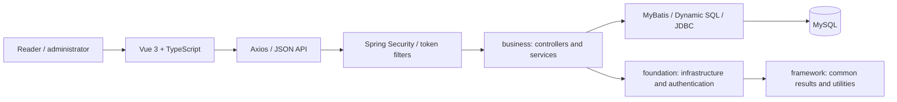

# BJTU Online Library

**A full-stack course project for catalog discovery, personal bookshelves and library administration, built with Spring Boot and Vue 3.**

**Team lead and primary backend contributor: Xinying Liu (Ashley Liu).** Developed for the Distributed Systems course at Beijing Jiaotong University. This public source edition uses environment-based configuration and excludes original account records and third-party ebook contents.

[Architecture](#architecture) · [API inventory](docs/api-inventory.json) · [My contributions](docs/CONTRIBUTIONS.md) · [Setup](#local-setup) · [Release scope](docs/PUBLIC_RELEASE.md)

## What the project does

| Area | Implemented source modules |
|---|---|
| Catalog | Book records, category browsing, search, pagination and detail views |
| Personal library | Bookshelf records and user-profile views |
| Administration | Catalog CRUD, Excel import/export and recommendation records |
| Authentication | Spring Security login handlers, password hashing, token utilities and role/permission data models |
| Integration | JSON APIs, Axios request handling, Vue Router and a Vite development proxy |

The recommendation module manages recommendation records; it is not a trained recommendation model. The course name describes the academic context: the recovered implementation is a modular application with a separate client and relational database, rather than a demonstrated distributed consensus system.

## My engineering contribution

I led the team and completed the majority of the backend work: Spring Boot integration, database design, API implementation and frontend/backend connection. I coordinated the stack and feature plan, helped teammates configure their development environments, and supported debugging across module boundaries. I also collaborated on catalog search, pagination, categories and sorting.

The frontend and overall project delivery were team efforts. The [contribution statement](docs/CONTRIBUTIONS.md) draws on my individual course report and preserves the distinction between project work and inherited framework utilities.

## Architecture



The backend separates business endpoints from infrastructure and reusable framework classes. The frontend uses `/api` requests and a development proxy to port 9090. Catalog controllers delegate to service and data-access layers; SQL support classes define table and column mappings.

| Layer | Technology |
|---|---|
| Backend | Java 17+, Spring Boot 3.0.4, Gradle |
| Persistence | MyBatis, MyBatis Dynamic SQL, JDBC, MySQL |
| Client | Vue 3, TypeScript, Vue Router, Axios, Vite |
| Supporting features | Spring Security, BCrypt, token utilities, Excel handling |

The actual dependency manifests use MyBatis and MyBatis Dynamic SQL. Their names are used here even though the original contribution report describes MyBatis Plus.

## API examples

The catalog API follows the recovered controller contracts, including POST-based query endpoints:

| Method | Path | Purpose |
|---|---|---|
| POST | `/api/bookLibrary/page` | Paginated catalog query |
| POST | `/api/bookLibrary/get` | Retrieve a book record |
| POST | `/api/bookLibrary/create` | Create a catalog record |
| POST | `/api/bookLibrary/update` | Update a catalog record |
| POST | `/api/bookLibrary/delete` | Delete a catalog record |
| POST | `/api/bookLibrary/importExcel` | Import catalog rows |
| POST | `/api/bookLibrary/exportExcel` | Export catalog rows |

The [machine-readable inventory](docs/api-inventory.json) lists routes extracted from 19 controllers. These are source contracts; successful live calls are not claimed by this release.

## Local setup

Use Java 17+, Gradle 8.0.1, a Node.js runtime compatible with the pinned frontend dependencies, and MySQL. The original Gradle wrapper pointed at a developer's local archive; its distribution URL now points to the standard Gradle distribution. The recovered folder did not contain `gradlew`, so these instructions use an installed Gradle executable.

1. Initialize a local database using [docs/schema-starter.sql](docs/schema-starter.sql). It supplies ten mapping-derived tables and one synthetic catalog record. Review constraints and provision local users/roles before exercising authenticated flows; this is not a full replacement for the original database.
2. Set local environment variables in the shell that launches the backend:

```powershell
$env:DB_URL = "jdbc:mysql://127.0.0.1:3306/library_demo?useUnicode=true&characterEncoding=UTF-8&serverTimezone=UTC"
$env:DB_USERNAME = "library_demo"
$env:DB_PASSWORD = "YOUR_LOCAL_DATABASE_PASSWORD"
$env:JWT_SECRET = "YOUR_RANDOM_SIGNING_SECRET_AT_LEAST_64_UTF8_BYTES"
$env:JASYPT_PASSWORD = "YOUR_LOCAL_CONFIGURATION_SECRET"
cd t11-server
gradle :business:bootRun
```

3. In another terminal, start the client:

```powershell
cd t11-web
npm ci
npm run dev
```

The backend binds to `127.0.0.1:9090`. Optional WeCom login needs your own `VITE_WECOM_APP_ID` and `VITE_WECOM_AGENT_ID`; institutional identifiers are not included.

## Verification and current limits

See [docs/VALIDATION.md](docs/VALIDATION.md) for the checks actually completed for this public edition. Backend startup and database-backed user flows have not been verified in this packaging environment. Some original permission annotations are disabled, and account provisioning needs additional work before deployment. The source is suitable for reviewing the course project's architecture and implementation; it is not presented as a production-ready service.

## Repository layout

```text
t11-server/
  business/     Catalog, bookshelf, recommendation, user and admin modules
  foundation/   Authentication, SQL infrastructure and shared services
  framework/    Common responses, entities, utilities and exceptions
t11-web/
  src/          Vue pages, routes, Axios integration and assets
  public/       Client static assets and editor distribution
docs/           Contributions, API inventory, starter schema and release checks
publish-github.ps1  Public repository creation and upload helper
```

## Further engineering work

The next useful extensions are database-backed authorization tests, reproducible account provisioning, input validation for catalog writes, migration-managed schema changes and pagination/query-index benchmarks. Any performance claims should include dataset size, query shape and measured timings.

## Source and rights

This is a team course project, with inherited framework and UI dependencies. Original notices are preserved. See [THIRD_PARTY_NOTICES.md](THIRD_PARTY_NOTICES.md); no blanket license is assigned to third-party or inherited source. Ebook files, database dumps, dependency folders and private configuration are excluded from Git.
