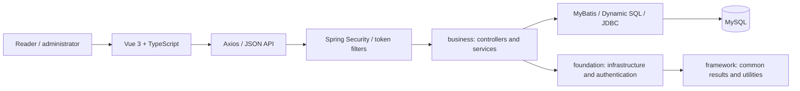
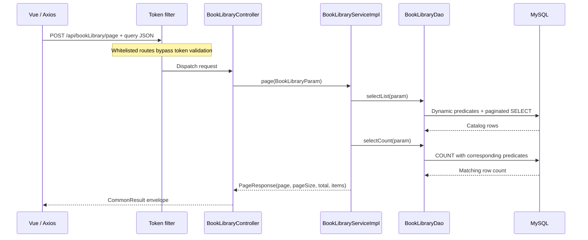
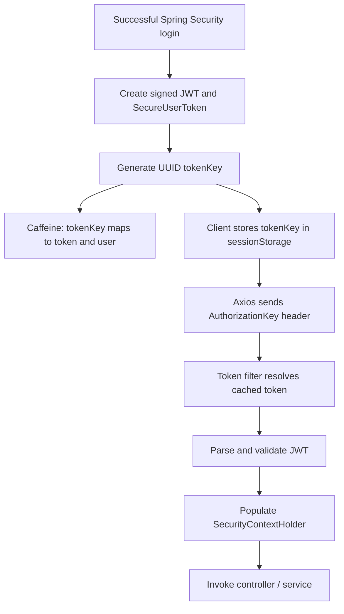

# BJTU Online Library

**A modular Spring Boot backend and Vue 3 client for catalog discovery, personal bookshelves and library administration, with dynamic SQL, paginated APIs and token-based authentication.**

**Team lead and primary backend contributor: Xinying Liu (Ashley Liu).** Developed for the Distributed Systems course at Beijing Jiaotong University. This public source edition uses environment-based configuration and excludes original account records and third-party ebook contents.

[Architecture](#architecture) · [API inventory](docs/api-inventory.json) · [My contributions](docs/CONTRIBUTIONS.md) · [Setup](#local-setup) · [Release scope](docs/PUBLIC_RELEASE.md)

## What the project does

| Area | Implemented source modules |
|---|---|
| Catalog | Book records, category browsing, search, pagination and detail views |
| Personal library | Bookshelf records and user-profile views |
| Administration | Catalog CRUD, Excel import/export and recommendation records |
| Authentication | Spring Security login handlers, password hashing, token utilities and role/permission data models |
| Integration | JSON APIs, Axios request handling, Vue Router and a Vite development proxy |

The recommendation module manages recommendation records; it is not a trained recommendation model. The course name describes the academic context: the recovered implementation is a modular application with a separate client and relational database, rather than a demonstrated distributed consensus system.

## My engineering contribution

I led the team and completed the majority of the backend work: Spring Boot integration, database design, API implementation and frontend/backend connection. I coordinated the stack and feature plan, helped teammates configure their development environments, and supported debugging across module boundaries. I also collaborated on catalog search, pagination, categories and sorting.

The frontend and overall project delivery were team efforts. The [contribution statement](docs/CONTRIBUTIONS.md) draws on my individual course report and preserves the distinction between project work and inherited framework utilities.

## Architecture



The backend separates business endpoints from infrastructure and reusable framework classes. The frontend uses `/api` requests and a development proxy to port 9090. Catalog controllers delegate to service and data-access layers; SQL support classes define table and column mappings.

| Layer | Technology |
|---|---|
| Backend | Java 17+, Spring Boot 3.0.4, Gradle |
| Persistence | MyBatis, MyBatis Dynamic SQL, JDBC, MySQL |
| Client | Vue 3, TypeScript, Vue Router, Axios, Vite |
| Supporting features | Spring Security, BCrypt, token utilities, Excel handling |

The actual dependency manifests use MyBatis and MyBatis Dynamic SQL. Their names are used here even though the original contribution report describes MyBatis Plus.

## API examples

The catalog API follows the recovered controller contracts, including POST-based query endpoints:

| Method | Path | Purpose |
|---|---|---|
| POST | `/api/bookLibrary/page` | Paginated catalog query |
| POST | `/api/bookLibrary/get` | Retrieve a book record |
| POST | `/api/bookLibrary/create` | Create a catalog record |
| POST | `/api/bookLibrary/update` | Update a catalog record |
| POST | `/api/bookLibrary/delete` | Delete a catalog record |
| POST | `/api/bookLibrary/importExcel` | Import catalog rows |
| POST | `/api/bookLibrary/exportExcel` | Export catalog rows |

The [machine-readable inventory](docs/api-inventory.json) lists routes extracted from 19 controllers. These are source contracts; successful live calls are not claimed by this release.

## Backend request lifecycle

A catalog query crosses explicit controller, service, SQL-construction and execution boundaries:



The controller handles HTTP binding and response wrapping. The service coordinates record operations and audit metadata. The DAO obtains a JDBC connection, renders a MyBatis Dynamic SQL provider into a `PrepareSqlRecord`, and delegates execution and entity mapping to `SimpleExecutor`. This is a **hybrid persistence layer**: it includes MyBatis infrastructure, while the catalog DAO explicitly executes rendered SQL through JDBC rather than relying solely on mapper proxies.

Source entry points: [controller](t11-server/business/src/main/java/com/t11/web/bookLibrary/controller/BookLibraryController.java), [service](t11-server/business/src/main/java/com/t11/web/bookLibrary/service/impl/BookLibraryServiceImpl.java), [DAO](t11-server/business/src/main/java/com/t11/web/bookLibrary/dao/BookLibraryDao.java), and [SQL builder](t11-server/business/src/main/java/com/t11/web/bookLibrary/sql/BookLibrarySql.java).

### Search and pagination semantics

The catalog predicate builder supports an optional exact ID and a title substring predicate using `isLikeWhenPresent`, with `%` added around the search term. Missing filters are omitted during SQL construction. The page endpoint separately obtains the result list and matching count, then returns these fields:

| Field | Meaning |
|---|---|
| `page` | Requested page number |
| `pageSize` | Requested page size |
| `total` | Matching record count |
| `items` | Returned catalog records |

This contract allows the client to render pagination without downloading the full catalog. It also exposes two engineering considerations: a leading-wildcard title search generally needs a different indexing strategy from a prefix search, and separate list/count queries can observe different database states during concurrent writes. Query-plan benchmarks and a defined read-consistency policy are appropriate follow-up work; neither is claimed as a measured result here.

### Record creation and updates

Creation initializes audit attributes from `UserContext`, assigns an ID through the Snowflake-style ID utility, and inserts the catalog record. Updates first retrieve the existing record, copy incoming properties while excluding ID and audit fields, initialize update attributes, and submit the update predicate. This keeps HTTP binding separate from persistence preparation, but does not establish optimistic concurrency control: no version-based compare-and-update contract is demonstrated in the catalog path.

The Excel import path processes rows individually and builds success/failure summaries. Its recovered duplicate lookup is a stub, and returned create/update failure flags are not consistently reflected in the counters. Consequently, **idempotent import, atomic batch rollback and accurate per-row failure accounting remain unfinished contracts**, rather than inferred capabilities of the Excel integration.

## Relational data model

The public starter schema is derived from source mapping classes. Its core entities are:

| Table | Responsibility | Important fields |
|---|---|---|
| `book_library` | Catalog metadata | `id`, `title`, `author`, `type`, `publication_time`, `cover`, `description` |
| `bookshelf` | Shelf representation | `id`, `name`, `allbooks` |
| `user_details` | User-associated reading data | `user_id`, `user_name`, `books` |
| `auth_user` | Account and profile attributes | `id`, `username`, `password`, `is_valid` |
| `auth_role` / `auth_perm` | Role and permission definitions | `id`, `code`, `name` |
| `auth_user_role_rel` | User-to-role association | `user_id`, `role_id` |
| `auth_role_perm_rel` | Role-to-permission association | `role_id`, `perm_id` |
| `basic_file` | Stored-file metadata | `group_id`, `name`, `content_type`, `path` |

The role association tables express a logical many-to-many authorization model. The mapping-derived starter schema does not enforce all foreign keys or uniqueness constraints. Shelf membership is stored in fields such as `allbooks` and `books`; a normalized user–book association table would make membership queries, duplicate prevention and ownership constraints easier to enforce. These details are visible in [schema-starter.sql](docs/schema-starter.sql), which contains synthetic data only.

## Authentication and request context

The authentication implementation combines Spring Security, JWT utilities and a server-side token registry:



The browser normally sends an **opaque UUID key**, not the JWT itself. The request filter can also read that key from a cookie. Verification resolves the corresponding `SecureUserToken` from Caffeine, parses its JWT, refreshes the cache entry and constructs a Spring Security authentication object. User identity can then be consumed by service code through `UserContext`.

`SessionCreationPolicy.STATELESS` disables HTTP-session persistence; authentication still depends on **process-local cached state**. This distinction matters for deployment: a server restart loses the registry, and a request routed to another replica cannot resolve a key created on the first instance. The source contains commented Redis alternatives, but this edition does not implement or claim a shared token store.

BCrypt is configured for password hashing. JWT signing material is supplied through `JWT_SECRET`, with a minimum 64-byte check. Database and Jasypt settings also come from environment variables. Frontend AES helpers only obfuscate UI storage and are not an authorization boundary.

Sources: [token registry](t11-server/foundation/src/main/java/com/foundation/springsecurity/secure/uutoken/SecureUserTokenService.java), [request filter](t11-server/foundation/src/main/java/com/foundation/springsecurity/secure/uutoken/SecureUserTokenSupport.java), and [Axios interceptor](t11-web/src/framework/axios.ts).

## Deployment and consistency considerations

| Boundary | Current implementation | Engineering implication |
|---|---|---|
| Client → backend | JSON requests; Vite `/api` proxy during development | A production reverse proxy and route fallback need separate configuration |
| Authentication state | Caffeine registry inside one JVM | Multiple replicas need shared state or a redesigned token-verification contract |
| SQL connections | Spring datasource configuration plus a separate static Hikari factory | Catalog JDBC work is not automatically proven to participate in Spring-managed transactions |
| Catalog mutation | Read existing record, then write | Concurrent updates need an explicit lost-update policy |
| Pagination | Separate list and count queries | Results and totals may diverge under concurrent changes |
| Authorization | Role/permission models; selected routes whitelisted; several checks commented out | Permission enforcement requires endpoint-level tests before deployment |
| Token invalidation | Registry removal helper currently reads the entry instead of invalidating it | Logout revocation requires a correction and regression test |

These are concrete system boundaries exposed by the source. The project demonstrates separation of client, application and database responsibilities; horizontal scalability, fault tolerance and distributed consistency would require additional implementation and evidence.

## Local setup

Use Java 17+, Gradle 8.0.1, a Node.js runtime compatible with the pinned frontend dependencies, and MySQL. The original Gradle wrapper pointed at a developer's local archive; its distribution URL now points to the standard Gradle distribution. The recovered folder did not contain `gradlew`, so these instructions use an installed Gradle executable.

1. Initialize a local database using [docs/schema-starter.sql](docs/schema-starter.sql). It supplies ten mapping-derived tables and one synthetic catalog record. Review constraints and provision local users/roles before exercising authenticated flows; this is not a full replacement for the original database.
2. Set local environment variables in the shell that launches the backend:

```powershell
$env:DB_URL = "jdbc:mysql://127.0.0.1:3306/library_demo?useUnicode=true&characterEncoding=UTF-8&serverTimezone=UTC"
$env:DB_USERNAME = "library_demo"
$env:DB_PASSWORD = "YOUR_LOCAL_DATABASE_PASSWORD"
$env:JWT_SECRET = "YOUR_RANDOM_SIGNING_SECRET_AT_LEAST_64_UTF8_BYTES"
$env:JASYPT_PASSWORD = "YOUR_LOCAL_CONFIGURATION_SECRET"
cd t11-server
gradle :business:bootRun
```

3. In another terminal, start the client:

```powershell
cd t11-web
npm ci
npm run dev
```

The backend binds to `127.0.0.1:9090`. Optional WeCom login needs your own `VITE_WECOM_APP_ID` and `VITE_WECOM_AGENT_ID`; institutional identifiers are not included.

## Verification and current limits

See [docs/VALIDATION.md](docs/VALIDATION.md) for the checks actually completed for this public edition. Backend startup and database-backed user flows have not been verified in this packaging environment. Some original permission annotations are disabled, and account provisioning needs additional work before deployment. The source is suitable for reviewing the course project's architecture and implementation; it is not presented as a production-ready service.

## Repository layout

```text
t11-server/
  business/     Catalog, bookshelf, recommendation, user and admin modules
  foundation/   Authentication, SQL infrastructure and shared services
  framework/    Common responses, entities, utilities and exceptions
t11-web/
  src/          Vue pages, routes, Axios integration and assets
  public/       Client static assets and editor distribution
docs/           Contributions, API inventory, starter schema and release checks
publish-github.ps1  Public repository creation and upload helper
```

## Further engineering work

The next useful extensions are database-backed authorization tests, reproducible account provisioning, input validation for catalog writes, migration-managed schema changes and pagination/query-index benchmarks. Any performance claims should include dataset size, query shape and measured timings.

## Source and rights

This is a team course project, with inherited framework and UI dependencies. Original notices are preserved. See [THIRD_PARTY_NOTICES.md](THIRD_PARTY_NOTICES.md); no blanket license is assigned to third-party or inherited source. Ebook files, database dumps, dependency folders and private configuration are excluded from Git.
